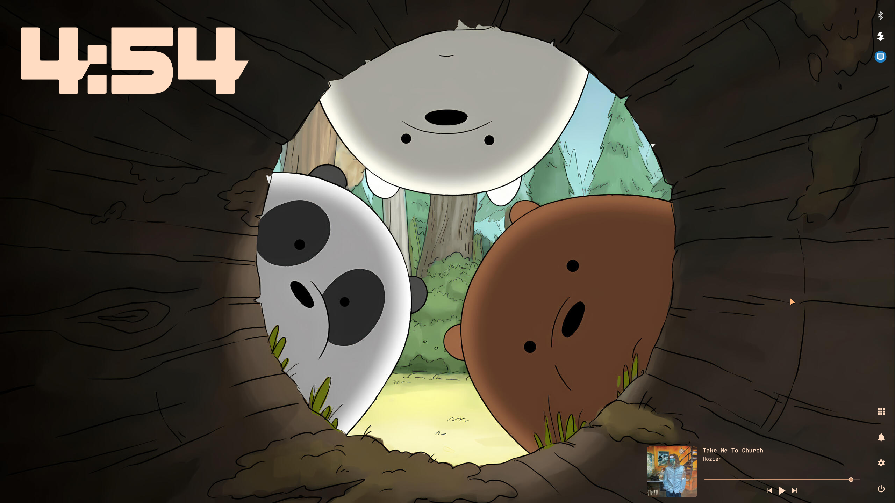
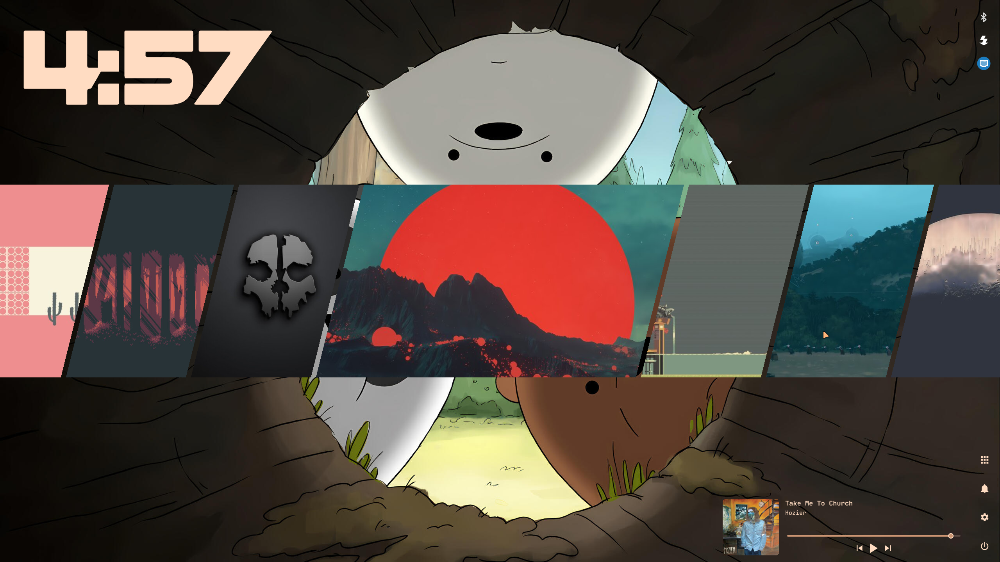
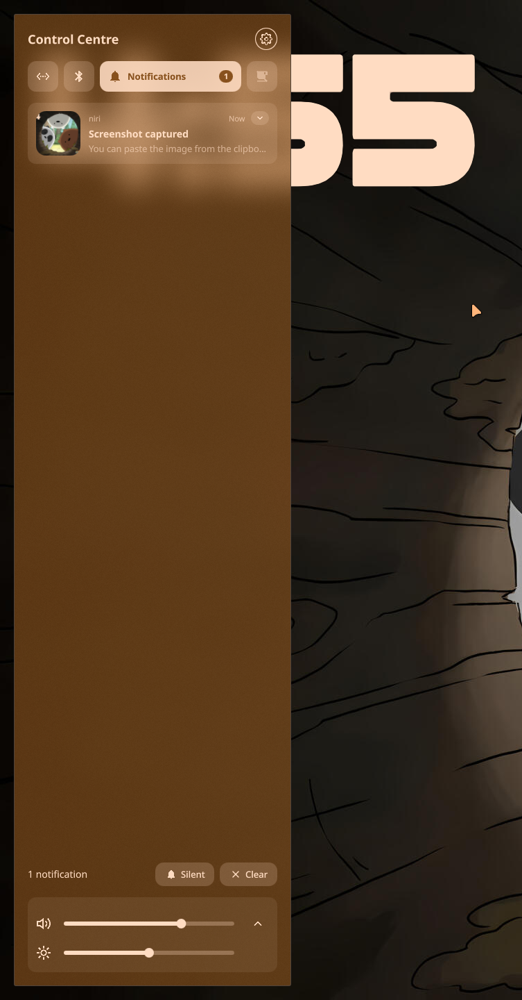
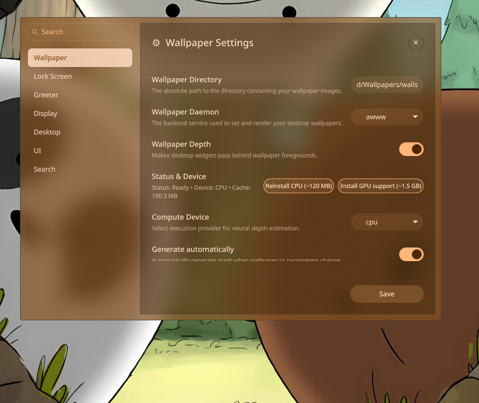

# Prism 💎

> A unified, feature-rich Wayland desktop shell built with [Quickshell](https://quickshell.outfoxxed.me/) for **Niri**, **MangoWM**, and **Hyprland**.

Prism is a fast, highly-customizable desktop environment layer providing modular widgets, application launchers, notifications, session locking, and hardware controls across modern Wayland compositors.

> [!WARNING]
> **Vibe Coded Project:** This is a fully vibe-coded project. If you are uncomfortable with this, please ignore this repository.

---

## ✨ Features

Prism provides a comprehensive suite of desktop components designed for productivity and aesthetics:

- **Desktop Widgets & Wallpaper Depth**: Clock, calendar, and media widgets featuring neural depth estimation that seamlessly tucks widgets behind background elements.
- **Spotlight Search**: Fast, unified macOS/KRunner-style search indexing applications and files via `plocate`.
- **App Launcher**: Full-featured grid launcher with fuzzy search and categorized views.
- **Control Center & Notifications**: Manage desktop notifications, volume/brightness sliders, network status, and hardware quick-toggles.
- **Settings GUI**: Centralized control center for wallpaper selection, neural depth estimation (CPU/GPU), lockscreen customization, and display preferences.
- **Wallpaper Selector**: Live wallpaper browser with Material You dynamic color generation via `matugen`.
- **Keybindings Cheatsheet**: Quick visual overlay showing your compositor's configured keybinds and shell actions.
- **Clipboard Manager**: Fast, keyboard-navigable clipboard history manager with search and image preview support.
- **Emoji Picker**: Searchable emoji picker with context-aware auto-paste into the active window.
- **Color Picker**: Screen color picker with magnifying loupe and auto-copy to clipboard.
- **Blue Light Filter**: Auto sunrise/sunset night light with smooth gamma transitions via the Wayland `wlr-gamma-control` protocol.
- **Idle Dimming**: Smart pre-lock panel dimming for both laptop displays and external monitors (DDC/CI).
- **Desktop MPRIS & Audio**: Persistent desktop player widget with cover art, playback scrubbing, and audio sink selection.
- **Power Menu**: Clean system power controls (Lock, Logout, Reboot, Shutdown).
- **Lockscreen & Greetd Login**: Secure lockscreen (`ext-session-lock-v1`) and multi-compositor `greetd` login screen featuring PAM authentication.
- **OSD**: Sleek on-screen display notifications for volume and brightness adjustments.

---

## 📸 Screenshots

### Desktop with Widgets & Wallpaper Depth


### Spotlight Search


### App Launcher


### Wallpaper Selector


### Notification Center


### Settings Window


### Clipboard Manager


### Keybindings Cheatsheet


### Lock Screen & Greeter


---

## 📦 Dependencies

### Core Requirements
- **[Quickshell](https://quickshell.outfoxxed.me/)**: The core QML desktop shell runtime (`qs`).
- **Supported Wayland Compositor** (any of the following):
  - **[niri](https://github.com/niri-wm/niri)** (25.11+ recommended)
  - **[MangoWM](https://github.com/DreamMaoMao/mangowm)**
  - **[Hyprland](https://hyprland.org/)**
- **greetd**: Display manager daemon (required for the built-in login greeter).
- **qt6-5compat**: Qt6 compatibility module for QML transitions and effects.
- **jq**: JSON processing utility for scripts.
- **python3**: Required for geolocation, search indexing, and greeter IPC bridge.
- **wl-clipboard**: Wayland clipboard utilities (`wl-copy`, `wl-paste`).
- **wtype** *(optional)*: Virtual keyboard utility for emoji auto-paste (`ydotool` supported as fallback).

### Theming & Multimedia
- **awww** / **swww**: Animated Wayland wallpaper daemon.
- **matugen**: Material You dynamic theme generation from wallpaper palette.
- **magick (ImageMagick)**: Thumbnail scaling and wallpaper processing.
- **playerctl**: MPRIS media player controls and track metadata.
- **pipewire-pulse** / **pulseaudio-utils**: Provides `wpctl` and `pactl` for audio control.
- **ffmpeg**: Video thumbnail generation.

### Hardware & System
- **brightnessctl**: Laptop backlight adjustments.
- **ddcutil**: External monitor brightness control via DDC/CI.
- **bluez-utils**: Provides `bluetoothctl` for Bluetooth status and battery levels.
- **systemd / logind**: Power actions via `loginctl` and `systemctl`.
- **plocate**: High-speed file search backend for Spotlight Search.

---

## 🛠️ Installation

1. **Install Quickshell**: Follow the instructions at [quickshell.outfoxxed.me](https://quickshell.outfoxxed.me/).
2. **Clone the repository**:
   ```sh
   git clone <repository_url> ~/.config/quickshell/prism
   ```
3. **Run the installer**:
   ```sh
   cd ~/.config/quickshell/prism
   ./deploy-install/install.sh
   ```
   *The installer detects your compositor, sets up cache/state directories, migrates any legacy configuration files, configures Matugen theming, and optionally sets up the `greetd` login screen.*

4. **Launch Prism**:
   ```sh
   qs -c prism
   ```

---

## 🎮 Compositor Autostart & Keybindings

Ready-made configuration snippets are provided in [`deploy/`](deploy/):

### For Niri (`~/.config/niri/config.kdl`):
```kdl
include "prism-niri.kdl"
```
*(or copy from `deploy/prism-niri.kdl`)*

### For MangoWM (`~/.config/mango/config.conf`):
```ini
source = ~/.config/mango/prism-mango.conf
```
*(or copy from `deploy/prism-mango.conf`)*

### For Hyprland (`~/.config/hypr/hyprland.conf`):
```ini
source = ~/.config/hypr/prism-hyprland.conf
```
*(or copy from `deploy/prism-hyprland.conf`)*

---

## ⚡ IPC Control

Prism is controlled via Quickshell IPC. You can bind these commands to any key combination:

| Action | IPC Command |
|---|---|
| **App Launcher** | `qs -c prism ipc call launcher toggle` |
| **Spotlight Search** | `qs -c prism ipc call search toggle` |
| **Wallpaper Selector** | `qs -c prism ipc call wallpaper toggle` |
| **Notification Center** | `qs -c prism ipc call notif toggle` |
| **Clipboard History** | `qs -c prism ipc call clipboard toggle` |
| **Emoji Picker** | `qs -c prism ipc call emoji toggle` |
| **Color Picker** | `qs -c prism ipc call colorpicker toggle` |
| **Settings** | `qs -c prism ipc call settings toggle` |
| **Power Menu** | `qs -c prism ipc call power toggle` |
| **Keybindings Overlay** | `qs -c prism ipc call keybinds toggle` |
| **Lock Screen** | `qs -c prism ipc call lock lock` |
| **Theme Reload** | `qs -c prism ipc call theme reload` |

For a complete list of commands and methods:
```sh
qs -c prism ipc call help display
```
