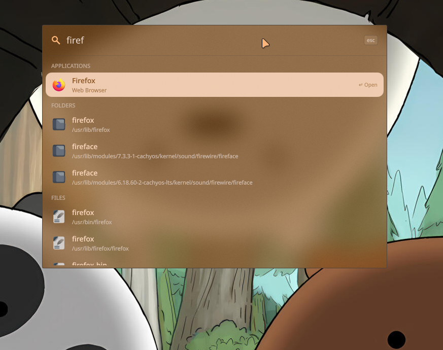
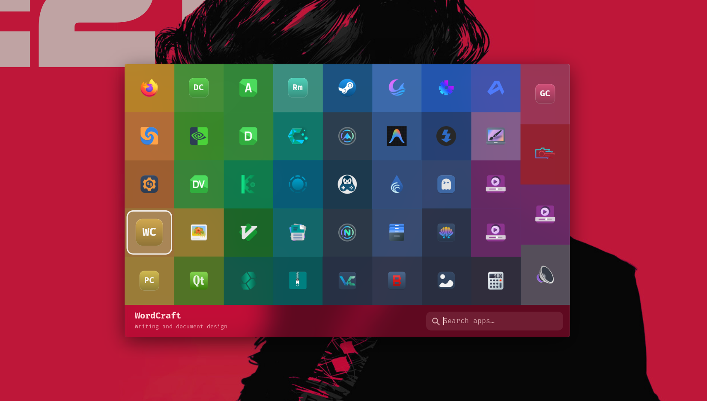
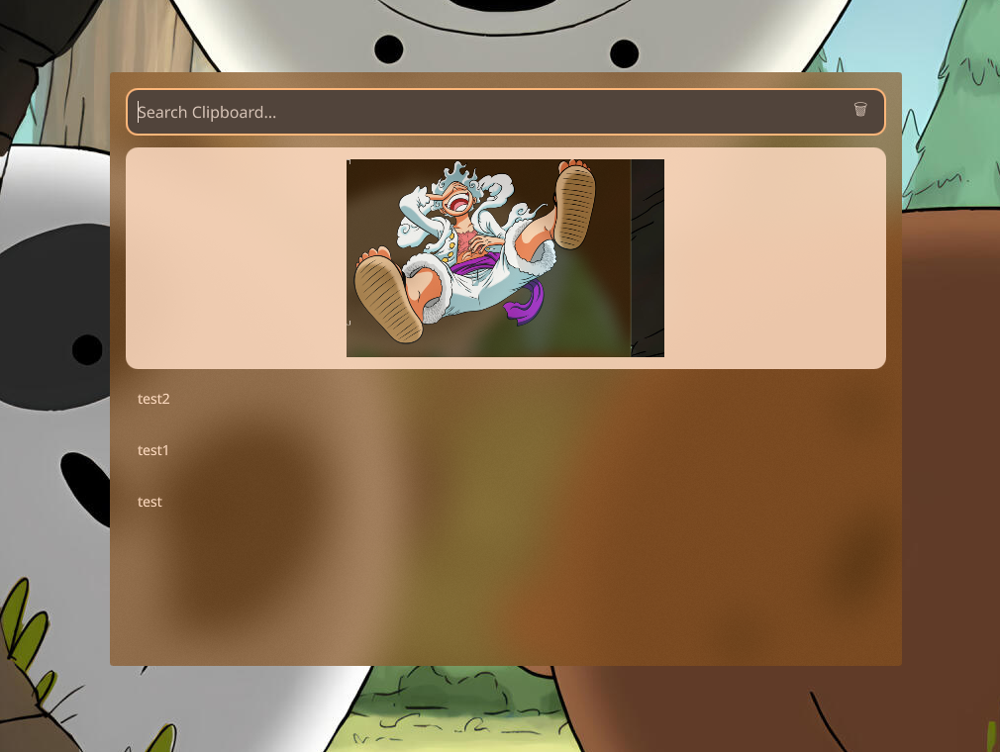
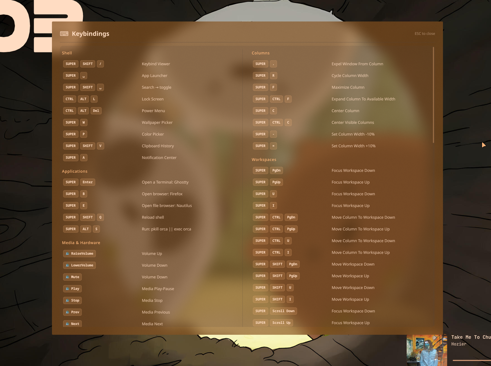
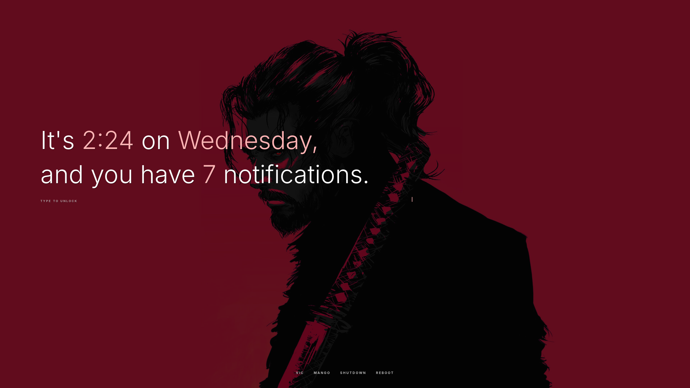
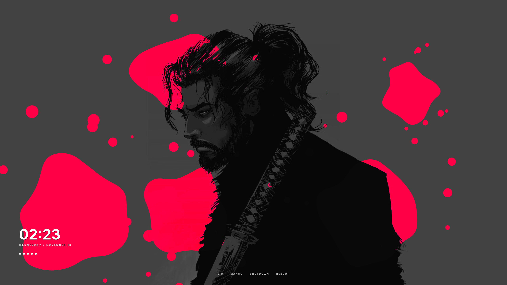
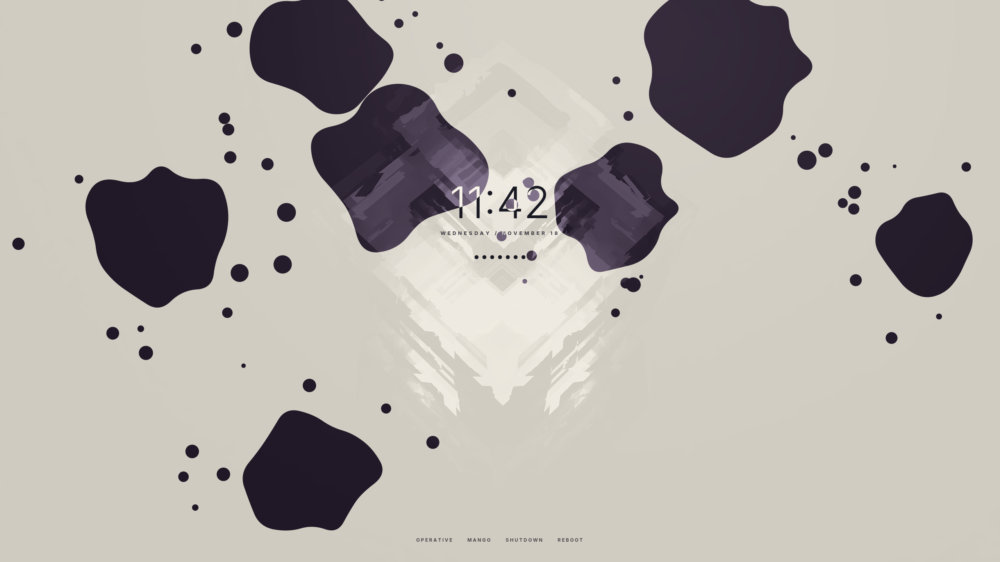
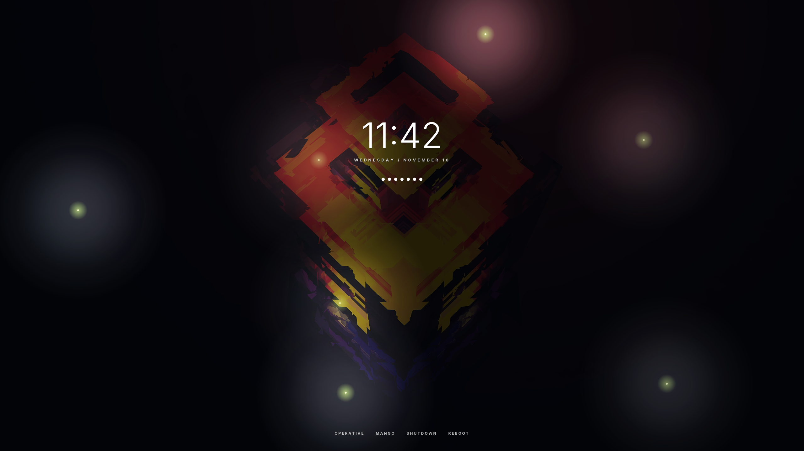

<p align="center">
  <picture>
    <source media="(prefers-color-scheme: light)" srcset="assets/logo/prism-lockup-light.png">
    
  </picture>
</p>

# Prism

> A native Rust Wayland desktop shell for **MangoWM**, with config snippets for **Niri** and **Hyprland**.

Prism is a desktop shell (launcher, search, notification center, desktop widgets, lock screen, greeter and more)
written in Rust. It started as a Quickshell/QML shell and was ported to Rust to cut GPU and CPU use: it draws with
cairo/pango straight into Wayland layer surfaces, runs one resident UI process and sits at 0% CPU when idle.

> [!WARNING]
> **Vibe Coded Project:** This is a fully vibe-coded project. If you are uncomfortable with this, please feel free to ignore this repository.

---

## ✨ Features

- **App launcher and Spotlight search**: fuzzy app search plus files and folders via `plocate`. The launcher comes
  in four designs: **Classic**, **Slices** (the wallpaper cut into one strip per app), **Spectrum** (a mosaic sorted
  by icon colour) and **Deck** (a floating hand of cards). Apps without an icon get their initials on their own colour.
- **Notification center**: notification history grouped by app, quick toggles, Wi-Fi and Bluetooth pages
  (NetworkManager and BlueZ over D-Bus, with pairing), volume and brightness sliders, audio output switching.
- **Notification server**: `org.freedesktop.Notifications` built into `prismd` (actions, urgency, images,
  do-not-disturb); popups can sit in any corner or edge. Screenshot notifications show a large preview.
- **Screenshots and screen recording**: a frozen-screen overlay to capture a region (move and resize handles), a
  window (searchable list) or the whole screen. Screenshots are saved as PNG and copied to the clipboard, with
  Open, Show in folder and Delete in the notification. Recordings use FFmpeg (NVENC, else x264) into MKV or MP4,
  with optional desktop audio and microphone (PipeWire); a small indicator shows the time and a Stop button.
- **Phone sync**: pairs with the official [KDE Connect](https://kdeconnect.kde.org/) Android app (no
  `kdeconnectd` needed). Phone battery and status, its media with controls and album art, the PC's players on the
  phone (multimedia control), clipboard sync both ways, phone notifications (reply right in the popup, dismiss),
  find my phone, files both ways, and the phone as a remote mouse and keyboard. Shown in a Phone card, a desktop widget and a Settings tab.
- **Desktop portal**: screenshots, colour picking and screen sharing for apps (browsers, OBS, Discord) through
  `xdg-desktop-portal`, with a picker for the screen or window to share. Replaces `xdg-desktop-portal-wlr`.
- **System prompts**: polkit and NetworkManager password prompts, and gnome-keyring's unlock prompts (replaces
  `gcr-prompter`), as Prism cards.
- **Removable drives**: USB drives and SD cards are mounted when plugged in and announced with Open and Eject.
- **Updates**: a notification and a bar module when package updates are available (`checkupdates`, `yay`/`paru`).
- **Game mode**: one toggle (notification center, `prism-ctl gamemode`) for silent notifications, the performance
  power profile and no animations or blur.
- **Quick answers**: calculator, unit conversion, `> command` and web search in the launcher and search.
- **Per-app volume** in the Control Centre's output panel, and a **privacy indicator** while the microphone or
  camera is in use or the screen is shared.
- **Window switcher** (Alt+Tab) with live thumbnails; Settings checks the compositor's own Alt+Tab binding and
  says what to change.
- **Copy text** from the screen (OCR with tesseract) in the screenshot overlay.
- **Download manager**: downloads over several connections (added on the fly, fewer when a server limits them),
  pause and resume even across restarts, a queue and a speed limit (`prism-ctl download`, Settings > Downloads).
  A pill at the top of the screen shows the real progress in percent; a failed download says why, with Retry
  in its notification. The **Downloads card** (`prism-ctl download toggle`, or click the pill) lists Prism's
  downloads with their controls. See [Firefox extension](#firefox-extension-prism-downloads).
- **Prism Downloads for Firefox** (`extension/`): hands browser downloads to Prism (a card confirms the name and
  folder first), adds "Download with Prism" to the link menu and lists downloads in its popup. It finds the videos a
  page plays (HLS streams with their qualities, whole video files) and puts a "Download video" button over them,
  like Brisk; streams are saved as MP4, with the headers the page used so stream hosts do not refuse them. The
  switch in its popup turns the whole extension off. It talks to Prism through native messaging
  (`prism-native-host`), not an open port.
- **First-time setup guide**: a short tour on first start with the main options (look, wallpaper, desktop, lock,
  notifications, night light, capture, downloads, phone), ending with any programs Prism uses that are not
  installed yet and the command to install them (`prism-ctl setup` runs it again).
- **Timer and stopwatch** in the Control Centre (`prism-ctl timer`), **weather** and **notes** desktop widgets,
  **low battery warnings** and **silent mode on a schedule**.
- **Motion**: cards open and close on springs (and shrink back to the button they were opened from), rows fade in
  one after another, selection highlights glide between rows, lists scroll smoothly (touchpad scrolling follows
  the fingers and keeps its momentum), and switches and hover states animate. Cards cast a soft drop shadow
  (can be turned off). Animations can be slowed down, sped up or turned off.
- **Video wallpapers**: the built-in wallpaper can loop a video, also on the lock screen and greeter.
- **Bar**: a panel on any screen edge in three styles (full width, floating, islands), with workspaces, clock, system
  monitor, tray, media player and launcher, notification and power buttons. Drag modules between left, center and right
  in Settings.
- **Dock**: pinned and running apps on the bottom, left or right edge. Right-click an app to pin or remove it. It can
  stay up, auto-hide, or hide only while windows are on screen, and hovering the screen edge brings it back.
- **Desktop widgets**: clock, analog clock, calendar, media player, phone, device batteries, an animated cat, system tray and shortcuts on the bottom layer,
  arranged in an on-screen edit mode. Widgets can be "sent to the background" so the wallpaper's foreground
  (a neural depth mask) passes in front of them.
- **System tray**: StatusNotifierItem host with tooltips and dbusmenu context menus (scrollable when long).
- **Lock screen and greeter**: `ext-session-lock-v1` lock with PAM, and a greetd greeter under `cage`. Nine designs:
  **Classic**, **Stencil** (the wallpaper seen through a giant clock), **Sentence** (the time and your
  notifications as a sentence), **Aperture** (a circular window that opens as you type), **Tide** (colour splashes
  that fill the greyscale wallpaper on unlock), **Ink** (ink blots bleeding into a paper-white wallpaper),
  **Fireflies** (a night-time wallpaper lit by a firefly per key; over a video each firefly opens a window onto it), **Halftone** (a dot screen whose dots merge into
  the picture as you type and on unlock and **Rings** (the wallpaper cut into concentric rings that turn as you
  type and line up on unlock). The greeter mirrors the lock
  screen or uses its own design, and clicking the user or session cycles through them.
- **Power menu**: five large designs (**Glide Bar**, **Split Panel**, **Shutters**, **Orbit** and **Floating
  Cards**). Choose which actions appear: Lock, Logout, Suspend, Sleep, Hibernate, Reboot and Shutdown (Sleep and
  Hibernate only where the computer supports them). Logout, Reboot and Shutdown can require a one-second hold.
- **Theming**: Material You palette from [matugen](https://github.com/InioX/matugen), applied live everywhere.
- **Wallpaper filters**: pick Color Pop, Pop Art, Synthwave, Noir or Vivid with small previews when applying a
  wallpaper. The filter shows on the desktop, lock screen and greeter alike, and can be turned off.
- **Blue light filter**: colour temperature through `wlr-gamma-control`, on a schedule or sunrise/sunset.
- **Idle handling**: screens dim 30 s before auto-lock; caffeinate (idle inhibitor) from the notification center.
- **Clipboard history**: text and images, stored with `0600` permissions; entries from password managers and
  password-like text are never saved.
- **Colour picker**: frozen-screen magnifier; copies the hex value to the clipboard.
- **Emoji picker, wallpaper selector, power menu, keybind viewer** (parsed from the MangoWM, Niri or Hyprland config)
  and a **settings** window (searchable, grouped under section headings) with live apply and undo.
- **On-screen display** for volume and brightness (`wpctl`, `brightnessctl` or DDC/CI via `ddcutil`).

---

## 📸 Screenshots

### Desktop with Widgets & Wallpaper Depth


### Spotlight Search


### App Launcher

Choose a design in Settings > Launcher.

<table>
  <tr>
    <td width="50%" align="center"><br><b>Classic</b></td>
    <td width="50%" align="center"><br><b>Slices</b></td>
  </tr>
  <tr>
    <td width="50%" align="center"><br><b>Spectrum</b></td>
    <td width="50%" align="center"><br><b>Deck</b></td>
  </tr>
</table>

### Wallpaper Selector


### Notification Center


### Clipboard Manager


### Keybindings Cheatsheet


### Lock Screen

Choose a design in Settings > Lock Screen. The greeter can mirror it or use its own (Settings > Greeter).

<table>
  <tr>
    <td width="50%" align="center"><br><b>Classic</b></td>
    <td width="50%" align="center"><br><b>Stencil</b></td>
  </tr>
  <tr>
    <td width="50%" align="center"><br><b>Sentence</b></td>
    <td width="50%" align="center"><br><b>Aperture</b></td>
  </tr>
  <tr>
    <td width="50%" align="center"><br><b>Tide</b></td>
    <td width="50%" align="center"><br><b>Ink</b></td>
  </tr>
  <tr>
    <td width="50%" align="center"><br><b>Fireflies</b></td>
    <td width="50%" align="center"><br><b>Halftone</b></td>
  </tr>
  <tr>
    <td width="50%" align="center"><br><b>Rings</b></td>
  </tr>
</table>

---

## 🏛️ Architecture

```
  prism-ctl ──(IPC: $XDG_RUNTIME_DIR/prism.sock)──► prismd ──(IPC: prism-ui.sock)──► prism-ui daemon
  (keybinds)                                        │                                 │
                                                    │ systemd user service            │ one Wayland connection,
                                                    │ notifications (D-Bus)           │ every overlay and the
                                                    │ idle, gamma, depth, clipboard   │ desktop widgets
                                                    ▼                                 ▼
                         prism-lock (session lock / greetd greeter)
                         prism-phoned (phone sync, while enabled)
                         prism-rec (screen recorder, while recording)
```

| Crate | Role |
|---|---|
| `prismd` | Background daemon (systemd user unit). IPC socket, notification server, idle monitor and dimming, blue light (gamma), clipboard watchers, depth mask worker, lock supervision. Starts and supervises one resident `prism-ui daemon`. |
| `prism-ui` | All UI in one process: modal cards (launcher, search, settings, ...), notification popups, OSD, colour picker, capture overlay and desktop widgets. Draws with cairo/pango, paced by `wl_surface.frame` callbacks. |
| `prism-ctl` | Command-line client; compositor keybinds call it. Every command: `man prism-ctl`. |
| `prism-lock` | Lock screen (`ext-session-lock-v1`) and greetd greeter (`--greeter`, under `cage`). |
| `prism-phone` (`prism-phoned`) | Phone sync over the KDE Connect protocol (v8), run by `prismd` while phone sync is on. |
| `prism-capture` | Screen capture core (`ext-image-copy-capture-v1`, screencopy fallback) shared by `prism-ui` and `prism-rec`. |
| `prism-rec` | Screen recorder (FFmpeg, PipeWire audio), run by `prismd` only while recording. |
| `prism-download` | Download engine: segmented HTTP downloads that add connections while they help, with pause and resume. Used by `prismd`'s download manager. |
| `prism-common` | Shared library: config, theme, IPC types, app/file search, clipboard store, hardware helpers. |

Apps launched from Prism run in their own systemd scope (`app.slice`), so restarting `prismd` never closes them.

---

## 📦 Building & Installation

### Requirements

- **Rust** 1.88 or newer.
- **Libraries**: wayland-client, xkbcommon, cairo, pango/pangocairo, gdk-pixbuf, GTK 3 (`gdk`), PAM, FFmpeg
  (libavcodec, libavformat, libavutil, libswscale, libswresample) and PipeWire for the recorder, and libclang at
  build time (bindings for FFmpeg and PipeWire).
- **Runtime programs and services**. Each feature needs only its own. `prism-ctl deps` lists what is missing on
  this computer (the installer runs it at the end and offers to install it, and the setup guide's last page shows
  it). Packages are named as on Arch Linux:

| Program / service | Package | Used for |
|---|---|---|
| **Needed** | | |
| `wpctl` | `wireplumber` | Volume and microphone, the sound OSD |
| `pw-dump` | `pipewire` | Per-app mixer, Sound page, privacy indicator |
| `xdg-open` | `xdg-utils` | Opening files, folders and links |
| `gsettings` | `glib2` | Following the icon theme |
| `fc-list` | `fontconfig` | Font lists in Settings |
| xdg-desktop-portal | `xdg-desktop-portal` | Screen sharing, screenshots for apps, folder pickers |
| **Recommended** | | |
| `matugen` | `matugen-bin` (AUR) | Palette from the wallpaper |
| NetworkManager | `networkmanager` | Wi-Fi, Ethernet and VPN pages |
| BlueZ | `bluez bluez-utils` | Bluetooth page (when the computer has Bluetooth) |
| UPower | `upower` | Battery levels and low battery warnings |
| power-profiles-daemon | `power-profiles-daemon` | Power profiles, game mode |
| UDisks2 | `udisks2` | Mounting and ejecting USB drives |
| Secret Service | `gnome-keyring` | Calendar addresses in the keyring (and app passwords) |
| `pkexec` | `polkit` | Changes that need your password (Prism is the polkit agent) |
| `ffmpeg` | `ffmpeg` | Trimming recordings, GIFs, joining downloaded videos |
| `curl` | `curl` | Weather, online calendars, sunset times |
| `pactl` | `libpulse` | Choosing sound devices and ports |
| `brightnessctl` | `brightnessctl` | Screen brightness (laptops) |
| **Optional** | | |
| `ddcutil` | `ddcutil` | Brightness of external monitors |
| `tesseract` | `tesseract tesseract-data-eng` | Copy text from the screen |
| `wtype` | `wtype` | Typing an emoji from the emoji picker |
| `plocate` | `plocate` | Finding files in Search (`pkexec updatedb` rebuilds the index) |
| `checkupdates` | `pacman-contrib` | Counting package updates |
| obexd | `bluez-obex` | Receiving files over Bluetooth |
| `python3` | `python` | Keybind viewer, wallpaper depth (installs its own venv) |
| `greetd`, `cage` | `greetd cage` | The login screen (greeter; the installer checks them when you set it up) |
| `awww` or `swww` | | Only when chosen instead of the built-in wallpaper daemon |
| KDE Connect app on the phone | | Phone sync (open UDP 1716 and TCP 1714-1764 in the firewall) |

Clipboard (ext-data-control), media control (MPRIS, `prism-ctl media play-pause|next|previous|stop` for media
keys), notifications and wallpaper resizing are built in; wl-clipboard, playerctl, libnotify and ImageMagick
are not needed. Also built in, each switched on in Settings: the wallpaper daemon (Wallpaper tab, replaces
awww/swww), monitor resolution, scale, rotation and adaptive sync (Display tab, replaces wlr-randr), and under
the System and Connections tabs an MPRIS bridge for MPD (mpd-mpris), the polkit agent (polkit-gnome), Wi-Fi/VPN password prompts
(nm-applet; with optional saving of VPN user names and passwords), Bluetooth file receiving (blueman) and
Network / Bluetooth tray icons (VPN, device and send-file menus). The Control Centre has a VPN page (connect,
filter, bulk import of .ovpn / WireGuard files through `nmcli`), Bluetooth devices have a Send button, and its
tiles are chosen in Settings > Notifications. Stop the program a service replaces before turning it on.

### Build and install

```bash
./deploy/install.sh
systemctl --user enable --now prismd
```

The installer checks the build dependencies, builds the workspace and installs:
- the binaries (`prismd`, `prism-ui`, `prism-ctl`, `prism-native-host`, `prism-lock`, `prism-phoned`, `prism-rec`,
  `prism-video`) to `~/.local/bin/`;
- helper scripts to `~/.local/share/prism/scripts/`;
- the `prism-ctl(1)` man page to `~/.local/share/man/man1/`;
- `prismd.service` to `~/.config/systemd/user/`.

At the end it checks the programs and services Prism uses at run time (the table above), lists what is missing
and offers to install it with `pacman`. The first time Prism starts, the setup guide opens by itself; its last
page lists anything still missing.

Run from a terminal, it asks whether to add `~/.local/bin` to your shell's PATH when it is missing (so `prism-ctl`
works from a terminal and from compositor keybinds), whether to install the lock screen's PAM service, and, on the
first install, whether to set up the login screen (greeter, below). Nothing outside your home directory changes unless you say yes there.
`--greeter`, `--no-greeter` and `--yes` answer without asking.

Run it again to update: it restarts `prismd` when it is running (apps you opened keep running) and offers to update
the greeter when it is installed. `prismd` starts `prism-ui` itself. Do not also start `prismd` from the compositor
config.

### Compositor

Include the snippet for your compositor. It sets up the keybinds and, for MangoWM, the layer rules (blur only behind cards):

| Compositor | Add to config |
|---|---|
| MangoWM (`~/.config/mango/config.conf`) | `source=/path/to/prism/deploy/prism-mango.conf` |
| Niri (`~/.config/niri/config.kdl`) | `include "/path/to/prism/deploy/prism-niri.kdl"` |
| Hyprland 0.55+ (`~/.config/hypr/hyprland.lua`) | `require("prism")`, after `ln -s /path/to/prism/deploy/prism-hyprland.lua ~/.config/hypr/prism.lua` |

`prismd` starts with `graphical-session.target`, so start Niri with `niri-session`. Older Hyprland releases may need
UWSM to reach that target.

`prismd.service` also starts `xdg-desktop-autostart.target`, which runs the XDG autostart entries
(`~/.config/autostart`, `/etc/xdg/autostart`) once per session. MangoWM does not run them otherwise. Do not also
launch those apps from the compositor config (`exec-once`, `dex -a`), or they run twice.

### Theme

Add the template in `deploy/matugen/prism-colors.json` to `~/.config/matugen/config.toml` as
`[templates.prism-rust]`, writing to `~/.config/prism/colors.json`.

### Firefox extension (Prism Downloads)

Install **Prism Downloads** from addons.mozilla.org, or build it yourself: `deploy/package-extension.sh` writes
`target/extension/prism-downloads-<version>.xpi` (signing steps in the script), and `about:debugging` > This
Firefox > Load Temporary Add-on (`extension/manifest.json`) loads it until Firefox restarts. Nothing else to set
up: `prismd` registers `prism-native-host` with Firefox and LibreWolf when they are installed
(`~/.mozilla/native-messaging-hosts/prism_downloads.json`). The extension shows "Connected to Prism" in its
settings once Prism runs.

### Lock screen and greeter (optional, needs root)

```bash
# PAM service for the lock screen (otherwise "login" is used)
sudo install -Dm644 deploy/pam.d/prism /etc/pam.d/prism

# Check your password works before relying on the lock screen
prism-lock --check-auth

# Greeter (needs greetd and cage): answer yes when the installer asks, or pass --greeter.
# Through sudo it installs prism-lock to /usr/local/bin, /var/lib/greetd/prism
# and deploy/greetd/config.toml as /etc/greetd/config.toml (the old one backed up)
./deploy/install.sh --greeter
```

Test the greeter from a TTY (`sudo systemctl restart greetd`) before rebooting. The greeter reads the wallpaper,
palette and settings that Prism copies into `/var/lib/greetd/quickshell-greeter` (a directory your user must be able
to write to, e.g. through a shared group).

---

## ⚙️ Configuration

- `~/.config/prism/config.json`: every setting; edited by the Settings window (`prism-ctl settings toggle`) and
  reloaded live when the file changes.
- `~/.config/prism/colors.json`: matugen palette.
- Calendar feeds (Settings > Desktop > Calendars) are kept in your keyring (gnome-keyring or another
  Secret Service), not in `config.json`; your password shows and changes the list. Settings, their
  snapshots and backups are readable only by you.
- `~/.cache/prism/`: clipboard history, notifications, current wallpaper (private, `0700`).
- Screenshots go to `~/Pictures/Screenshots` and recordings to `~/Videos/Recordings` (both set in Settings > Capture).

Logs: `journalctl --user -u prismd -f` (covers `prism-ui` too). `PRISM_PERF=1` logs frame times.

---

## 💻 CLI Reference (`prism-ctl`)

Run `prism-ctl --help` for the full list. The common ones:

| Command | Action |
|---|---|
| `prism-ctl launcher toggle` | App launcher |
| `prism-ctl search toggle` | Spotlight search |
| `prism-ctl notif toggle` | Notification center (`notif silent on\|off` for do-not-disturb) |
| `prism-ctl settings toggle` | Settings |
| `prism-ctl wallpaper toggle` | Wallpaper selector (`wallpaper set <path>` to set one) |
| `prism-ctl clipboard toggle` | Clipboard history |
| `prism-ctl emoji toggle` | Emoji picker |
| `prism-ctl colorpicker toggle` | Colour picker |
| `prism-ctl screenshot toggle` | Capture overlay (`screenshot screen` for the whole screen at once) |
| `prism-ctl screenshot record` | Start or stop recording (`screenshot stop` to stop) |
| `prism-ctl phone toggle` | Phone card (`phone pair`, `phone ring`, `phone send <file>...`) |
| `prism-ctl power toggle` | Power menu (`power suspend`, `sleep`, `hibernate`, `reboot`, `shutdown` run one directly) |
| `prism-ctl keybinds toggle` | Keybind viewer |
| `prism-ctl lock lock` | Lock the session |
| `prism-ctl osd volume +5` / `-5` / `mute` | Volume with OSD |
| `prism-ctl osd brightness +5` / `-5` | Brightness with OSD |
| `prism-ctl media play-pause` | Media control (`next`, `prev`, `stop`) |
| `prism-ctl caffeinate on\|off` | Hold or release the idle inhibitor |
| `prism-ctl bluelight toggle` | Blue light filter on/off |
| `prism-ctl desktop edit` | Desktop widget edit mode |
| `prism-ctl depth generate` | Generate the depth mask for the current wallpaper |
| `prism-ctl index status` | File index state (`index rebuild` to rebuild) |
| `prism-ctl download toggle` | Downloads card (`download add <url>`, `list`, `pause`, `resume`, `cancel <id>`) |
| `prism-ctl setup` | The first-time setup guide |
| `prism-ctl deps` | Programs and services Prism uses that are missing (works without `prismd`) |
| `prism-ctl ping` | Check that `prismd` responds |

---

## 📄 License

GPL-3.0 License.
